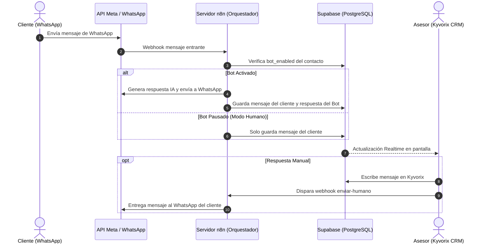

# Manual de Usuario — Kyvorix CRM

> **Plataforma Integral de Gestión de Clientes, Conversaciones Omnicanal y Pipeline Financiero**  
> *Versión:* 2.0 (Producción) | *Última actualización:* Octubre 2026

---

## Tabla de Contenidos
1. [Introducción y Arquitectura General](#1-introducción-y-arquitectura-general)
2. [Acceso al Sistema (Autenticación y Seguridad)](#2-acceso-al-sistema-autenticación-y-seguridad)
3. [Módulo de Conversaciones (Chat Omnicanal)](#3-módulo-de-conversaciones-chat-omnicanal)
   - 3.1. [Lista de Conversaciones y Búsqueda](#31-lista-de-conversaciones-y-búsqueda)
   - 3.2. [Alternancia entre Bot IA y Atención Humana](#32-alternancia-entre-bot-ia-y-atención-humana)
   - 3.3. [Envío de Mensajes y Webhooks](#33-envío-de-mensajes-y-webhooks)
   - 3.4. [Conversión Directa a Prospecto / Lead](#34-conversión-directa-a-prospecto--lead)
   - 3.5. [Eliminación Protegida de Conversaciones](#35-eliminación-protegida-de-conversaciones)
4. [Módulo de Clientes (Directorio y Ficha Técnica)](#4-módulo-de-clientes-directorio-y-ficha-técnica)
   - 4.1. [Listado y Filtrado Avanzado](#41-listado-y-filtrado-avanzado)
   - 4.2. [Detalle y Edición de Cliente](#42-detalle-y-edición-de-cliente)
   - 4.3. [Exportación Profesional a Excel (.xlsx)](#43-exportación-profesional-a-excel-xlsx)
5. [Módulo de Prospectos y Préstamos (Embudo Kanban)](#5-módulo-de-prospectos-y-préstamos-embudo-kanban)
   - 5.1. [Etapas del Embudo](#51-etapas-del-embudo)
   - 5.2. [Creación y Reubicación de Leads](#52-creación-y-reubicación-de-leads)
   - 5.3. [Métricas y Totales Financieros](#53-métricas-y-totales-financieros)
6. [Flujo Automatizado con WhatsApp y n8n](#6-flujo-automatizado-con-whatsapp-y-n8n)
7. [Preguntas Frecuentes y Solución de Problemas (FAQ)](#7-preguntas-frecuentes-y-solución-de-problemas-faq)

---

## 1. Introducción y Arquitectura General

**Kyvorix CRM** es un software de administración comercial diseñado para gestionar prospectos, clientes y préstamos financieros con soporte para atención automatizada vía Inteligencia Artificial y mensajería instantánea (WhatsApp).

### Componentes Clave:
- **Frontend Minimalista:** Diseñado bajo una estética moderna, limpia (estilo Messenger Blue `#0084FF` / `slate-900`) con soporte para pantallas de alta densidad y componentes visuales reactivos.
- **Backend en Supabase:** Base de datos PostgreSQL en tiempo real con políticas estrictas de seguridad por fila (**Row Level Security - RLS**).
- **Orquestador n8n:** Motor de webhooks para enviar y recibir mensajes directamente con la API de WhatsApp Cloud / Meta.

---

## 2. Acceso al Sistema (Autenticación y Seguridad)

Para ingresar al CRM:
1. Navegue a la URL del portal (ejemplo: `https://tu-crm.vercel.app/login` o `http://localhost:5173/login`).
2. Ingrese sus credenciales de acceso:
   - **Correo Electrónico:** Correo registrado en Supabase Auth (ej. `admin@gmail.com`).
   - **Contraseña:** Contraseña configurada en su cuenta.
3. Presione el botón **Iniciar Sesión**.
4. **Protección de Sesión (`ProtectedRoute`):** El sistema verifica continuamente la validez del token de sesión. Si el usuario cierra el navegador o expira el token, será redirigido automáticamente a la pantalla de Login para proteger la información confidencial de clientes.

---

## 3. Módulo de Conversaciones (Chat Omnicanal)

El módulo de chat es el centro operativo para interactuar con los contactos que se comunican vía WhatsApp.

### 3.1. Lista de Conversaciones y Búsqueda
- **Barra de Búsqueda:** Permite filtrar instantáneamente chats por nombre del cliente o número telefónico.
- **Pestañas de Estado:**
  - *Todos:* Muestra la totalidad de chats activos.
  - *Pendientes:* Conversaciones que requieren atención humana prioritaria o respuesta inmediata.
  - *En Ejecución:* Chats que están siendo atendidos en tiempo real por un asesor o por el bot.
  - *Cerrados:* Conversaciones archivadas o finalizadas.
- **Indicadores en Tiempo Real:** Las conversaciones no leídas muestran un contador numérico en azul.

### 3.2. Alternancia entre Bot IA y Atención Humana
En la cabecera del chat activo se ubica el interruptor inteligente de atención:
- **Modo Asistente IA (Verde / Activo):** El bot de n8n responde automáticamente las consultas del cliente usando su base de conocimiento y calificación de leads.
- **Modo Humano (Pausa del Bot):** Al desactivar el interruptor, el bot se silencia para ese contacto específico (`bot_enabled = false`). Un asesor humano puede intervenir y tomar el control total de la charla sin interferencias del bot.

### 3.3. Envío de Mensajes y Webhooks
1. Escriba el mensaje en la caja de texto inferior.
2. Presione **Enter** o el botón de envío (ícono de avión).
3. **Mecanismo Dual:**
   - El mensaje se guarda instantáneamente en la base de datos Supabase (`messages`).
   - El frontend dispara un webhook a n8n (`VITE_N8N_SEND_WEBHOOK`) para enviar el mensaje real al WhatsApp del cliente mediante la API de Meta.

### 3.4. Conversión Directa a Prospecto / Lead
Sin salir de la pantalla de chat, el asesor puede transformar una consulta en una oportunidad comercial:
1. En el panel lateral derecho del chat, localice el botón **Convertir en Prospecto**.
2. Al hacer clic, se despliega un formulario integrado:
   - **Monto Solicitado ($):** Monto estimado del préstamo o venta.
   - **Etapa Inicial:** Por ejemplo, *Nuevo Contacto*, *Evaluación Crediticia*, *Aprobado*, etc.
   - **Notas:** Información de contexto revelada en el chat (ej. "Negocio de repuestos con 4 años de antigüedad").
3. Al presionar **Guardar Prospecto**, el contacto se vincula inmediatamente al **Embudo Kanban** sin necesidad de reescribir sus datos.

### 3.5. Eliminación Protegida de Conversaciones
Para prevenir eliminaciones accidentales o pérdidas de auditoría:
1. Al hacer clic en el botón **Eliminar Conversación** (ícono de papelera en el panel derecho), se abre un **Modal de Confirmación**.
2. **Requisito Obligatorio:** El sistema exige escribir la **Razón de Eliminación** (ej. "Número equivocado", "Prueba interna", "Spam comercial").
3. El botón final de confirmación permanecerá **deshabilitado** hasta que el asesor ingrese una justificación válida.

---

## 4. Módulo de Clientes (Directorio y Ficha Técnica)

Ubicado en la pestaña lateral **Clientes**, este módulo centraliza la base de datos de personas y empresas.

### 4.1. Listado y Filtrado Avanzado
- Visualización en tarjetas compactas para maximizar el aprovechamiento del espacio visual.
- Búsqueda en vivo por nombre, teléfono o etiquetas personalizadas (*tags*).
- Calificación de Leads (*Lead Score*): Indicadores de temperatura (**Hot**, **Warm**, **Cold**) para priorizar llamadas de seguimiento.

### 4.2. Detalle y Edición de Cliente
Al hacer clic en un cliente, se abre el panel lateral de detalles donde es posible:
- Modificar el nombre comercial y teléfono.
- Añadir o eliminar etiquetas comerciales.
- Ver el historial de préstamos vinculados.
- Abrir directamente su chat activo con un solo clic.

### 4.3. Exportación Profesional a Excel (.xlsx)
En la esquina superior derecha del directorio de clientes se encuentra el botón **Exportar Excel**:
- **Formato Nativo .xlsx:** A diferencia de exportaciones en CSV que causan problemas de tildes o separadores de coma, Kyvorix genera un libro de cálculo nativo compatible con Microsoft Excel, Google Sheets y LibreOffice.
- Incluye cabeceras con estilo, columnas auto-ajustadas y los campos: Nombre, Teléfono, Estado de Bot, Puntuación (Score), Etiquetas y Fecha de Registro.

---

## 5. Módulo de Prospectos y Préstamos (Embudo Kanban)

El módulo **Embudo** (`FunnelBoard`) ofrece una perspectiva visual del pipeline de ventas o colocación de créditos.

### 5.1. Etapas del Embudo
Las columnas estándar reflejan el ciclo de vida del préstamo:
1. **Nuevo:** Contactos recién ingresados que han mostrado interés inicial.
2. **Contacto Inicial:** En conversación preliminar o recopilando requisitos básicos.
3. **En Negociación / Evaluación:** Análisis crediticio, revisión de balances o documentos (RTU, estados de cuenta).
4. **Ganado / Aprobado:** Crédito autorizado y formalizado.
5. **Perdido:** Prospecto no calificado o desistido.

### 5.2. Creación y Reubicación de Leads
- **Nuevo Lead:** Botón para registrar un préstamo manual especificando cliente, monto y notas.
- **Reubicación de Etapa:** Puede mover un prospecto entre etapas desde el menú rápido de la tarjeta o al editar sus detalles.

### 5.3. Métricas y Totales Financieros
En la parte superior de cada columna se calcula en tiempo real:
- Número de prospectos en esa fase.
- Sumatoria monetaria acumulada (ej. `$45,000 USD` en evaluación).

---

## 6. Flujo Automatizado con WhatsApp y n8n

---

## 7. Preguntas Frecuentes y Solución de Problemas (FAQ)

### ¿Qué hacer si no se envían los mensajes al cliente?
1. Compruebe si la URL del webhook en el archivo `.env` (`VITE_N8N_SEND_WEBHOOK`) coincide con el webhook de producción activo en su servidor n8n.
2. Verifique que la instancia de n8n esté activa y con el workflow en estado **Active**.
3. Confirme que el token de WhatsApp en n8n no haya expirado (Meta Business Manager).

### ¿Por qué el botón "Eliminar Conversación" está bloqueado?
El sistema tiene protección contra borrados involuntarios. Debe escribir al menos 3 caracteres en el cuadro de texto indicando la razón por la cual se elimina la conversación (por ejemplo: "Atendido por otra vía", "Número equivocado").

### ¿Cómo cambio la contraseña de un usuario?
1. Ingrese a [Supabase Dashboard](https://supabase.com).
2. Diríjase a **Authentication** > **Users**.
3. Localice el correo del usuario, haga clic en `...` y seleccione **Send password reset** o cambie la contraseña directamente.

### ¿Los datos se sincronizan en tiempo real?
Sí. Toda la aplicación utiliza los canales Realtime de Supabase. Si otro asesor contesta un chat o un cliente escribe por WhatsApp, el mensaje aparecerá en pantalla sin necesidad de recargar la página (**F5**).

---
*Manual generado para el equipo operativo y de soporte de Kyvorix CRM.*
